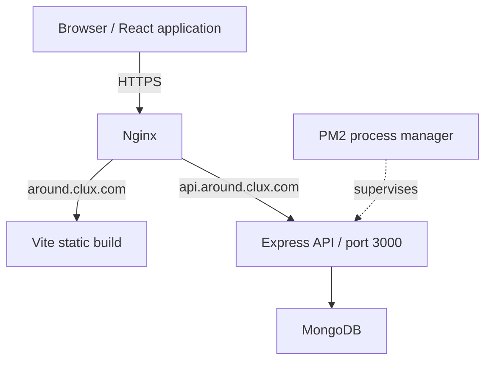

# Around the U.S. — Full-Stack

A deployed full-stack photo-sharing application with JWT authentication, server-enforced ownership permissions, automated API tests, and a React frontend backed by a Node.js/Express API on Google Cloud.

**React · JavaScript · Node.js · Express · MongoDB · Google Cloud**

[Live Application](https://around.clux.com) · [REST API (authentication required)](https://api.around.clux.com) · [Source Code](https://github.com/adrielfunini16/web_project_api_full)

Create an account, customize your profile, publish image cards, and like other users' photos. Everyone shares the gallery; only a card's owner can delete it. Images are supplied by URL rather than uploaded to the server.

Developed by **Adriel Funini** as the integrated **Sprint 18 project** of TripleTen's Full-Stack Web Development program. This version brings the earlier frontend and backend projects together under one API and cloud deployment. The application interface and API messages are primarily in Portuguese.

## Contents

- [Features](#features)
- [Architecture](#architecture)
- [Tech stack](#tech-stack)
- [Run locally](#run-locally)
- [REST API](#rest-api)
- [Authentication and security](#authentication-and-security)
- [Testing and verification](#testing-and-verification)
- [Deployment](#deployment)
- [Engineering highlights](#engineering-highlights)

## Features

- **Accounts and sessions:** registration, email/password login, token verification on reload, protected application routes, and logout.
- **Personal profiles:** update your name, description, and avatar URL; changes persist in MongoDB.
- **Shared gallery:** view cards from different accounts, open image previews, and create cards with a title and image URL.
- **Ownership checks:** the interface displays delete controls only for your cards; the API independently enforces ownership.
- **Likes:** like and unlike cards, with one user ID per card's likes array.
- **Ordering:** the React client sorts loaded cards by descending `createdAt` and places newly created cards first.
- **Feedback:** form validation, an initial authentication loading screen, and success/error messages through `InfoTooltip`.

## Architecture



| Layer | Responsibilities |
| --- | --- |
| React client | Components and Hooks, current-user context, routing, session state, forms, and gallery updates |
| HTTP client | `frontend/src/utils/apiClient.js` selects the API base URL, attaches Bearer tokens, and normalizes request errors |
| Express application | Routers dispatch requests through validation and authentication to controllers and Mongoose models |
| Startup | `backend/app.js` exports the application; `server.js` validates configuration, awaits the connection in `db.js`, then starts listening |
| Infrastructure | Nginx serves the frontend and proxies API requests; PM2 supervises Node.js; MongoDB stores users and cards |

The repository has separate `frontend/` and `backend/` applications, each with its own package manifest and lockfile. Backend code is organized into `routes/`, `controllers/`, `models/`, `middlewares/`, `errors/`, `utils/`, and `tests/`.

## Tech stack

| Responsibility | Technologies |
| --- | --- |
| Frontend | React 19, React Router 7, JavaScript, HTML, CSS, Context API, Fetch API, Vite 8 |
| Backend | Node.js, Express 5, Mongoose 9 |
| Database | MongoDB |
| Authentication and validation | bcrypt, jsonwebtoken, Celebrate/Joi, validator, cors |
| Logging | Winston and express-winston; JSON request and error logs |
| Testing and quality | Jest, Supertest, ESLint; Airbnb Base configuration in the backend |
| Deployment | Google Cloud Compute Engine, Ubuntu 22.04 LTS, Nginx, PM2, Certbot, HTTPS/TLS, DNS |
| Development | npm, Nodemon, Git and GitHub; Chrome DevTools for manual integration checks |

## Run locally

### Prerequisites

- Git and npm.
- Node.js compatible with the locked dependencies: **22.13.0 or later within Node 22, or Node 24+**. This accounts for Vite, Mongoose, and the frontend ESLint requirements.
- MongoDB installed locally and listening on `127.0.0.1:27017`.
- Repository access if the repository is private.

The commands below use **Bash/Git Bash** syntax. Run each application from its own directory; there is no root-level npm script.

### Install

```bash
git clone https://github.com/adrielfunini16/web_project_api_full.git
cd web_project_api_full
npm --prefix backend ci
npm --prefix frontend ci
```

Start your installed MongoDB service. Alternatively, if `mongod` is on your PATH and no local instance is already running, start a standalone instance in a separate terminal:

```bash
mkdir -p "$HOME/around-mongodb"
mongod --dbpath "$HOME/around-mongodb" --bind_ip 127.0.0.1 --port 27017
```

### Start the API

```bash
cd backend
npm run dev
```

The API listens on `http://localhost:3000`. Use `npm run start` to run without Nodemon.

**No `.env` file is required for development.** When `NODE_ENV` is unset, the backend uses development mode, the local `arounddb` database, and a development-only JWT fallback. A tracked `backend/.env.example` documents optional configuration; do not use its example secret in production.

### Start the frontend

In another terminal, from the repository root:

```bash
cd frontend
npm run dev -- --mode vm
```

Open `http://localhost:5173`. The `vm` mode selects the root base path; this is still a Vite development server, so API requests default to `http://localhost:3000`.

Plain `npm run dev` uses the inherited `/web_project_around_auth/` base path instead. In that case, open `http://localhost:5173/web_project_around_auth/`. Keep port `5173` available because it is the default allowed local CORS origin.

### Configuration reference

| Variable | Behavior |
| --- | --- |
| `NODE_ENV` | Backend modes: `development`, `test`, or `production`; defaults to development |
| `PORT` | Backend listening port; defaults to `3000` |
| `JWT_SECRET` | Required in test and production; only development permits a fallback |
| `MONGO_URI` | Development always selects `mongodb://127.0.0.1:27017/arounddb`; test requires exactly `mongodb://127.0.0.1:27017/around_test`; production requires an explicit, separate database |
| `CORS_ORIGINS` | Optional comma-separated list replacing the backend's default allowed origin |
| `VITE_API_BASE_URL` | Optional client API URL override; defaults to localhost in development and the deployed API in a production build |

Vite variables are public build configuration. Never put a JWT signing secret or database credentials in a `VITE_` variable. Production rejects the development/test database names `aroundb`, `arounddb`, and `around_test`.

## REST API

Base URL: `https://api.around.clux.com`.

Send JSON bodies with `Content-Type: application/json`. Authenticated requests use the token returned by login in the `Authorization` header with the `Bearer` scheme. The API root is not a public health-check endpoint and returns `401` without authentication.

| Method | Endpoint | Purpose | Authentication |
| --- | --- | --- | --- |
| POST | `/signup` | Register with email/password and optional profile fields | Public |
| POST | `/signin` | Authenticate and return a JWT | Public |
| GET | `/users` | List users without password hashes | JWT |
| GET | `/users/me` | Retrieve the authenticated user | JWT |
| GET | `/users/:userId` | Retrieve a user by ID | JWT |
| PATCH | `/users/me` | Update the current user's `name` and `about` | JWT |
| PATCH | `/users/me/avatar` | Update the current user's `avatar` URL | JWT |
| GET | `/cards` | Retrieve the shared gallery | JWT |
| POST | `/cards` | Create a card with `name` and `link` | JWT |
| DELETE | `/cards/:cardId` | Delete a card | JWT + ownership |
| PUT | `/cards/:cardId/likes` | Add the current user's like | JWT |
| DELETE | `/cards/:cardId/likes` | Remove the current user's like | JWT |

Passwords must contain 8–30 characters. Profile names, descriptions, and card names use 2–30 characters. URL fields use a shared `validator.isURL` check, and ID parameters must be 24 hexadecimal characters.

Registration and card creation return `201`; successful login, reads, updates, likes, and deletion return `200`. Login returns an object with a `token` field. User/card operations return documents directly, collection reads return arrays, and card deletion returns a confirmation message. Card ownership comes from the verified JWT, not the request body.

| Error | Meaning |
| --- | --- |
| 400 | Invalid input, malformed JSON, or invalid ID format |
| 401 | Invalid credentials, or a missing, invalid, or expired JWT |
| 403 | Attempt to delete another user's card |
| 404 | Requested document or authenticated route not found |
| 409 | Duplicate registration email |
| 500 | Unexpected server error |

Errors use a single `message` field. For example, this is the actual validation-error format:

```json
{
  "message": "Dados inválidos fornecidos"
}
```

Unknown routes pass through authentication first: without a valid token, they can return `401` before the `404` handler is reached.

## Authentication and security

- Passwords are hashed with bcrypt using a cost factor of 10. The Mongoose password field has `select: false`; login explicitly selects it for verification, while registration excludes it from the response.
- JWTs carry the user's `_id` and expire after seven days. Middleware verifies the token before protected resource handlers run.
- The client keeps the JWT in React state and `localStorage`, verifies it through `/users/me`, and clears session state and local storage on logout. Guards prevent responses from a previous session from updating the next session.
- Profile updates use the authenticated user's ID. Card deletion checks ownership on the server; repeated likes use MongoDB `$addToSet`, and unlikes use `$pull`.
- Celebrate/Joi validates requests before controllers, with model validation as an additional layer. Centralized error handling returns controlled messages.
- CORS defaults to the deployed frontend in production and `http://localhost:5173` otherwise. CORS is a browser policy, not a replacement for API authentication.
- JSON logging records method, route pattern, status, duration, and error category without recording request/response bodies or authorization headers. Environment files and logs are excluded by `.gitignore`.

This is an educational full-stack application, not a claim of complete security assurance. Tokens in `localStorage` remain accessible to scripts running on the same origin. Logout removes the client copy; it does not revoke an already-issued JWT on the server.

## Testing and verification

### Automated backend tests

Five Jest/Supertest suites are present:

| Suite | Scope |
| --- | --- |
| `auth.test.js` | Registration, login, token validation, rejected credentials, and error responses |
| `users.test.js` | User reads, profile/avatar changes, isolation, validation, and simulated failures |
| `cards.test.js` | Creation, shared reads, ownership, likes, persistence, and simulated failures |
| `cors.test.js` | Environment-specific origins, custom origins, preflight, and protected routes |
| `logger.test.js` | JSON metadata, error categories, and exclusion of sensitive data |

Run from `backend/`, with local MongoDB running. The following command generates a temporary signing secret for the test process without printing it:

```bash
NODE_ENV=test \
MONGO_URI=mongodb://127.0.0.1:27017/around_test \
JWT_SECRET="$(node -e 'process.stdout.write(require("node:crypto").randomBytes(32).toString("hex"))')" \
npm test -- --runInBand
```

The database-backed suites create and clean up their own test records and refuse a URI other than the exact `around_test` URI above. Do not point them at production. For a coverage report, use the same environment settings with `npm run test:coverage -- --runInBand`; no coverage percentage is claimed here.

Run `npm run lint` separately inside `backend/` and `frontend/`.

### Verification record

**100 backend tests passed across five Jest/Supertest suites** in the recorded local run. Production API checks also verified authentication, validation, resource ownership, and data operations; a controlled recovery test verified automatic PM2 restart. These are separate test activities, not a claim of full automated browser E2E coverage.

| Evidence | Result and scope |
| --- | --- |
| Historical local test run | Five suites and 100 tests passed, as recorded in the supplied pre-deployment audit summary; not rerun for this documentation update |
| Historical lint/build checks | Reported as successful in the supplied audit summary, with an existing frontend warning; not a new clean-run claim |
| Production API QA — 11 Nov 2026 | Work verified registration `201`, duplicate email `409`, rejected authentication `401`, unauthorized deletion `403`, validation `400/404`, profiles, cards, and likes. Two temporary cards were deleted afterward |
| Developer's manual production checks | Registration/login, profile/avatar edits, card operations, likes, reload persistence, shared gallery, ownership controls, logout, and token removal were reported as tested with multiple accounts and Chrome DevTools |
| Controlled recovery test — 11 Nov 2026 | The developer reported a temporary `502`, PM2 restart count increasing from 2 to 3, process returning online, and a subsequent unauthenticated `/users/me` request returning `401` |

The production API audit did **not** certify a complete browser E2E flow: logout, `InfoTooltip`, and mobile behavior remained unverified by Work. No availability metric, CI status, or automated browser E2E coverage is claimed.

## Deployment

The developer's deployment record describes a **Google Cloud Compute Engine VM running Ubuntu 22.04 LTS**, with MongoDB on the same VM:

- Nginx serves the React static build at `around.clux.com` and proxies `api.around.clux.com` to Node.js on internal port **3000**.
- Certbot manages HTTPS certificates, and DNS routes the domain and API subdomain to the deployment.
- PM2 supervises the **`around-fullstack`** process. The process list was saved and startup integration enabled.
- Production uses `NODE_ENV=production`, `PORT=3000`, a private `JWT_SECRET`, and a `MONGO_URI` selecting **`around_production`**, separate from development and test databases.

The recovery result above documents a successful controlled PM2 restart, not continuous availability. Infrastructure settings were supplied by the developer and were not re-inspected on the VM during this documentation update.

### Build for the VM

From `frontend/`:

```bash
npm run build:vm
```

This runs `vite build --mode vm` and writes `dist/` with the base path `/`. Plain `npm run build` retains the earlier `/web_project_around_auth/` base and is not the correct build for deployment at the domain root.

`npm run preview -- --mode vm` serves the built files locally; it does not start the backend or reproduce the production infrastructure. Production builds default to the production API, whose CORS policy does not allow the preview origin by default. Use the development workflow above for local integration work.

The existing `deploy` npm script combines the VM build with an owner-specific SCP destination. It is not a general setup command and should only be used after its target has been reviewed by the deployment owner.

<details>
<summary>Deployment resource note</summary>

A dependency-installation attempt was terminated under memory pressure. The developer configured 2 GiB of persistent swap, then completed dependency installation and the frontend build. Swap provides disk-backed memory support; it is not equivalent to additional RAM.

</details>

## Engineering highlights

This project connects application development with deployment responsibilities: a single authenticated API now serves the React client, resource ownership is enforced server-side, asynchronous session changes are handled explicitly, and development/test/production data are separated. Backend integration tests exercise both successful operations and controlled failures. Deploying behind Nginx and supervising Node.js with PM2 extends the work from implementing features to operating a running service.

Earlier stages focused on vanilla JavaScript, React authentication with external APIs, and an Express/Mongoose backend. This repository integrates that progression into a deployed full-stack application.

**Author:** [Adriel Funini](https://github.com/adrielfunini16) — Junior Software Engineer / Full-Stack Developer.